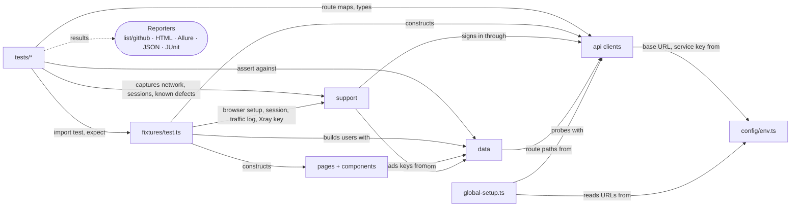
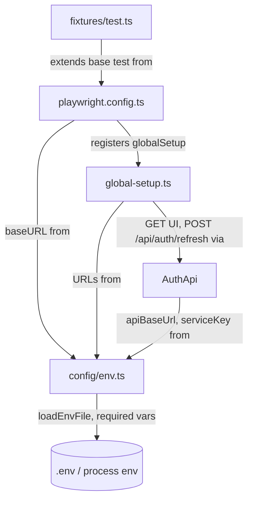
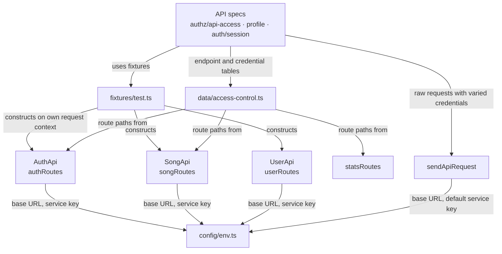
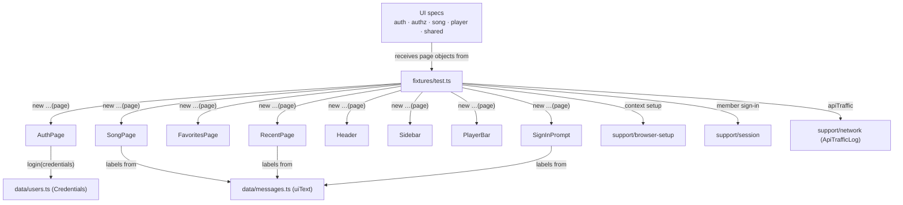
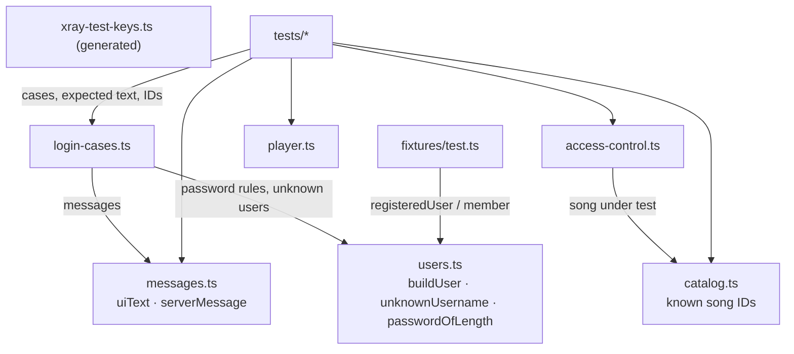
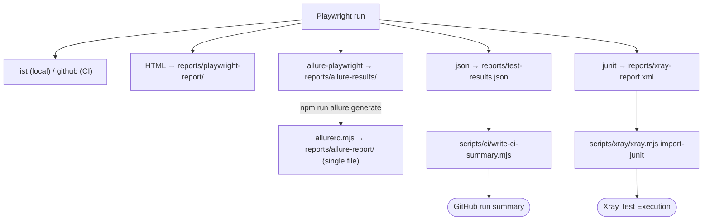
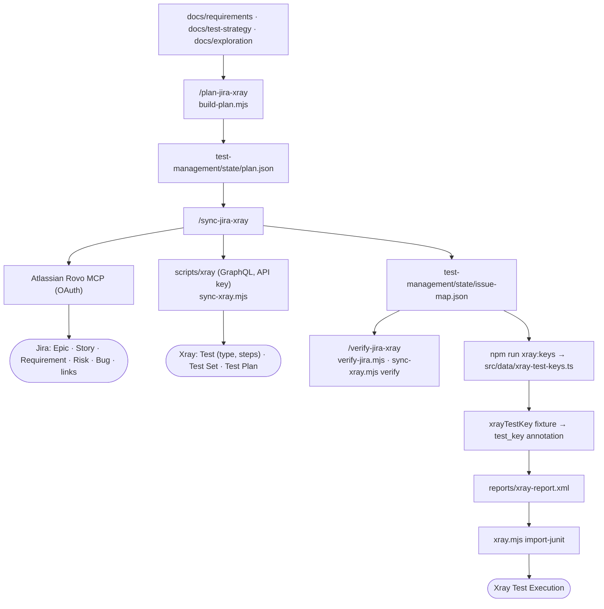
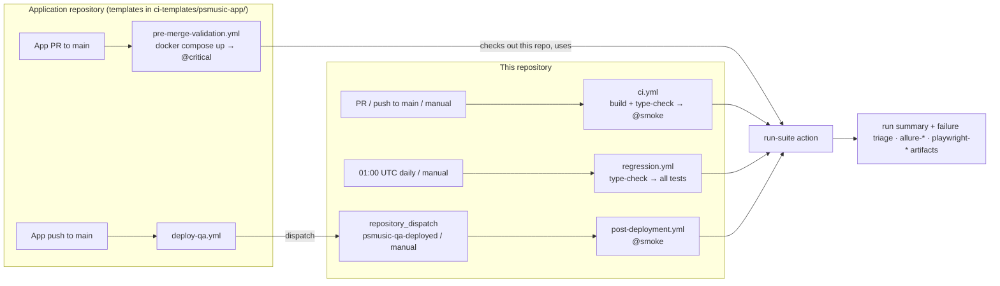
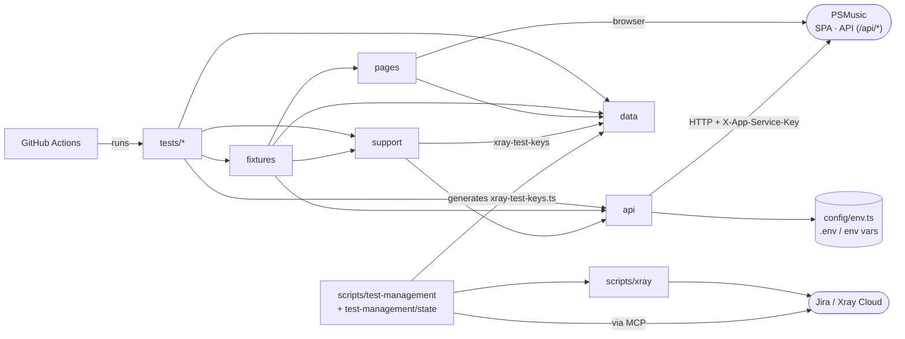
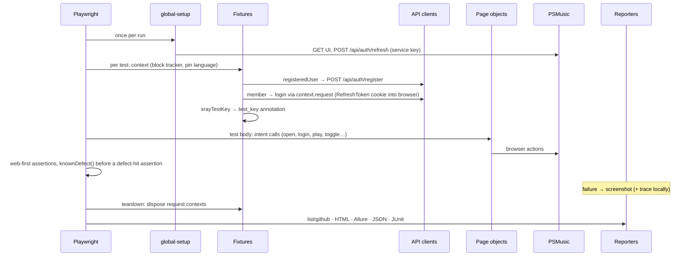

# PSMusic Automation Testing Project

UI + API + E2E test automation framework (TypeScript, Playwright Test, Allure, GitHub Actions, Jira/Xray) for the **PSMusic** music-streaming web application (React SPA + ASP.NET Core API).

## 1. Key documentation

| Document | Purpose |
|---|---|
| [Test Strategy](docs/test-strategy/test-strategy.md) | Objectives, scope, functional areas, test levels, data/environment/regression/CI strategy, traceability. Start here to understand *what* is tested and *why*. |
| [Test levels](docs/test-strategy/levels/) | Per-level detail: component integration, system, system integration, acceptance. |
| [User Stories](docs/requirements/user-stories.md) | Requirements (`US-xxx`) with acceptance criteria (`US-xxx-AC-nn`) that the tests assert. |
| [Risk Register](docs/test-strategy/risk-register.md) | Product (`PR-xx`) and test/project (`TR-xx`) risks with likelihood, impact, priority and mitigation tests. |
| [Test Scenarios](docs/test-strategy/test-scenarios.md) | Scenario catalogue (`TS-<AREA>-<NN>`, 117 scenarios). Test titles start with these IDs. |
| [Automation Analysis](docs/test-strategy/automation-analysis.md) | Scenario-by-scenario automate/manual classification, UI vs API split, deferred automation. |
| [Implementation Progress](docs/test-case-implementation-progress.md) | Which scenarios are automated (Yes / Partial / No), run results and open findings per area. |
| [Exploration findings](docs/exploration/) | Observed facts about the SUT from the browser, the application repository and its documentation; [`exploration-validation.md`](docs/exploration/exploration-validation.md) reconciles them. |
| [CI/CD](docs/ci-cd.md) | Workflows, triggers, suites, configuration, failure investigation, application-repository triggers. |
| [Failure triage](docs/failure-triage.md) | Evidence-based classification of failed tests (product / test / infrastructure / flaky / unknown) and recorded-Bug matching; report-only. |
| [Jira/Xray integration](docs/integrations/README.md) | How testware is planned, synced to Jira/Xray, verified, and how results are imported. |

## 2. Technology Stack

| Category | Technology | Purpose |
|---|---|---|
| Language | TypeScript 5.9 (`strict`, `noEmit`) | Framework and tests; `npm run typecheck` |
| Automation / runner | `@playwright/test` 1.63 | Browser automation, API calls (`APIRequestContext`), fixtures, tagging, retries |
| Browser | Chromium (Desktop Chrome device) | Only browser in scope (`docs/test-strategy/levels/system.md` §3) |
| API automation | Playwright `APIRequestContext` | `AuthApi`, `SongApi`, `UserApi`, `sendApiRequest` |
| Reporting | Allure 3 (`allure`, `allure-playwright`, `allure-js-commons`) + Playwright HTML, JSON, JUnit reporters | Single-file Allure report with plan-derived metadata, masked API evidence and failure categories ([`docs/reporting.md`](docs/reporting.md)), CI run summary, Xray import |
| Runtime | Node.js 22 (`process.loadEnvFile` for `.env`) | No `dotenv` dependency |
| Package manager | npm (`package-lock.json`, `npm ci`) | |
| Test management | Jira Cloud + Xray Cloud | Epics, Stories, Risks, Bugs, Tests, Test Sets/Plans/Executions (project `MSC`) |
| Jira channel | Atlassian Rovo MCP (`.mcp.json`, OAuth) | Jira reads/writes from Claude Code commands |
| Xray channel | Xray Cloud GraphQL v2 + REST import (`scripts/xray/`) | Test type/steps, set/plan membership, JUnit result import |
| Exploration | Playwright MCP, Postman | Inspect the running SUT before automating it |
| Database | *None accessed by the framework* | Test data is created through the HTTP API only |
| CI/CD | GitHub Actions | `ci.yml` (smoke), `regression.yml` (all), `post-deployment.yml` (smoke after QA deploy), app-repo templates — see `docs/ci-cd.md` |

## 3. Project Structure

```text
psmusic-playwright-automation/
├── package.json / package-lock.json         # scripts: test, test:smoke, test:regression, test:unit, typecheck, triage, allure:*, report:metadata, xray:keys, jira:export
├── playwright.config.ts                     # Chromium project, globalSetup, CI-aware retries/workers/trace, 5 reporters
├── playwright.unit.config.ts                # unit tests of the tooling (tests-unit/): no browser, no PSMusic
├── allurerc.mjs                             # Allure 3: single-file report, failure categories, local history → reports/allure-report/
├── tsconfig.json
├── reports/                                 # run output, git-ignored: test-results/, playwright-report/, allure-results/,
│                                            #   allure-report/, test-results.json, xray-report.xml, triage.json/.md
├── .env.example                             # PSMUSIC_* (tests) and ATLASSIAN_*/JIRA_*/XRAY_* (integration)
├── .mcp.json                                # Atlassian Rovo MCP server
├── CLAUDE.md                                # repository rules
├── .claude/
│   ├── commands/                            # /discover- /plan- /sync- /verify-jira-xray, /import-xray-results
│   └── rules/traceability-rules.md          # coverage, risk, defect and repeatability rules
├── .github/
│   ├── workflows/ci.yml                     # PR/push: build + type-check, then @smoke
│   ├── workflows/regression.yml             # nightly/manual: every test
│   ├── workflows/post-deployment.yml        # repository_dispatch from app's QA deploy: @smoke
│   └── actions/run-suite/                   # shared composite action: install, run, summary, triage, Xray, Allure, artifacts
├── ci-templates/psmusic-app/                # workflows to copy into the application repository
│   ├── pre-merge-validation.yml             # app PR: docker compose up, run @critical
│   └── deploy-qa.yml                        # app QA deploy → dispatch post-deployment here
├── docs/
│   ├── exploration/{browser,repository,documentation}/   # observed facts about the SUT
│   ├── requirements/user-stories.md
│   ├── test-strategy/                       # strategy, levels, risk register, scenarios, automation analysis
│   ├── integrations/                        # Jira/Xray API research, capability matrix, auth, troubleshooting
│   ├── ci-cd.md
│   ├── reporting.md                         # Allure report content, metadata, evidence, categories
│   ├── failure-triage.md                    # failure classification rules, Bug matching, phase 2 plan
│   ├── runbook.md                           # following results, failure triage, next commands
│   └── test-case-implementation-progress.md
├── scripts/                                 # every script explained in scripts/README.md
│   ├── ci/                                  # write-ci-summary (GitHub run summary), write-trigger-summary (post-deployment origin), xray-execution
│   ├── test-management/                     # build-plan, jira-export, sync-xray, verify-jira, issue-map, export-test-keys, export-test-metadata
│   ├── triage/                              # failure triage: collect, classify, bug-index, triage (report-only)
│   └── xray/                                # xray-client (auth, retry, redaction), jira-client, xray CLI, junit-for-xray
├── test-management/
│   ├── config/project-map.json              # verified Jira/Xray project configuration (no secrets)
│   ├── state/plan.json, issue-map.json      # planned entities; local ID → Jira key mapping (+ JSON Schemas)
│   ├── plans/, reports/                     # plan snapshots and redacted run reports
├── src/
│   ├── config/env.ts                        # loads .env, required PSMUSIC_* variables, appUrl()
│   ├── global-setup.ts                      # UI + API reachability / service-key probe before the suite
│   ├── fixtures/test.ts                     # extended `test`: API clients, users, page objects, Xray key
│   ├── api/                                 # auth-api, song-api, user-api, stats-api (routes), api-request
│   ├── pages/                               # auth, song, favorites, recent pages
│   │   └── components/                      # header, sidebar, player-bar, sign-in-prompt
│   ├── data/                                # users, catalog, messages, login-cases, access-control, player, xray-test-keys (generated)
│   ├── reporting/                           # Allure: metadata, @step, API exchanges, failure evidence, masking, environment
│   └── support/                             # browser-setup, session, network, jwt, set-cookie, lyrics, known-defect, xray
├── tests/                                   # tests
└── tests-unit/                              # unit tests of the tooling, with fixtures from a real run
```

| Folder | Responsibility |
|---|---|
| `src/config` | Environment values (`PSMUSIC_UI_URL`, `PSMUSIC_API_URL`, `PSMUSIC_SERVICE_KEY`); fails fast when one is missing |
| `src/fixtures` | The project's `test`/`expect`: every spec imports from here, never from `@playwright/test` directly |
| `src/api` | Route maps and typed clients over `APIRequestContext`; every call carries `X-App-Service-Key` |
| `src/pages` | Page objects and reusable components; locators are role/label/text-based |
| `src/data` | Test data: run-unique users, known catalog IDs, UI/server messages, data-driven cases |
| `src/reporting` | Allure reporting: plan-derived metadata, page-object `@step`, masked HTTP exchanges, failure evidence and signals ([`docs/reporting.md`](docs/reporting.md)) |
| `src/support` | Cross-cutting helpers: browser setup, session/cookie, network capture, known defects, Xray key lookup |
| `tests/<area>` | Specs grouped by functional area; titles start with the story and scenario IDs |
| `scripts`, `test-management` | CI summaries and the Jira/Xray toolchain with its persistent state |

## 4. Overall Architecture

Arrows mean "depends on / uses". Built from the actual imports.



## 5. Component Dependency Graphs

Legend: `A -->|label| B` = A depends on B; the label states what A takes from / does with B.

### 5.1 Configuration and lifecycle



| Component | Responsibility | Provides |
|---|---|---|
| `config/env.ts` | Loads `.env` if present (shell variables win); throws `Missing environment variable …` for any unset `PSMUSIC_*` | `env.uiBaseUrl`, `env.apiBaseUrl`, `env.serviceKey`, `appUrl(route)` |
| `playwright.config.ts` | `fullyParallel`; CI: `retries 1`, `workers 1`, `forbidOnly`, no trace; local: trace on failure; screenshots on failure; `ignoreHTTPSErrors` (mkcert / ASP.NET dev certs) | Runner settings, reporters, `chromium` project |
| `global-setup.ts` | Checks the UI responds and the API accepts the service key before any test | One clear failure instead of N connection errors |
| `fixtures/test.ts` | Extends Playwright `test` with every page object, API client and data fixture; overrides `context` for all UI tests | `test`, `expect` |

**Fixtures provided by `fixtures/test.ts`**

| Fixture | Scope / behavior |
|---|---|
| `context` (override) | Aborts recommendation-tracker hosts and pins UI language to English before the SPA boots |
| `authApi`, `songApi`, `userApi` | Each on its own `APIRequestContext` (own cookie jar), disposed after the test |
| `registeredUser`, `otherRegisteredUser` | Fresh run-unique accounts registered through the API on a throwaway context; not signed in |
| `member` | `registeredUser` whose session (HttpOnly `RefreshToken` cookie) is already in the browser context |
| `apiTraffic` | `ApiTrafficLog` recording the page's API calls |
| `authPage`, `songPage`, `favoritesPage`, `recentPage`, `header`, `sidebar`, `playerBar`, `signInPrompt` | Page objects bound to `page` |
| `xrayTestKey` (auto) | Adds a `test_key` annotation from the scenario ID in the title, for the JUnit/Xray import |

### 5.2 API layer



| Component | Endpoints (observed in the SUT) | Notes |
|---|---|---|
| `AuthApi` | `POST /api/auth/login`, `register`, `refresh`, `logout`; `GET /api/auth/me` | Cookie jar of the passed context holds `RefreshToken`; `registerOrThrow` / `loginOrThrow` for setup; `withoutToken()` redacts the JWT in assertion output |
| `SongApi` | `GET /api/song/{id}/detail`, `/related`, `/player`; `POST /api/song/{id}/favorite-toggle`; `/api/artist/{songId}/artists` | Optional bearer token for per-user fields; `…OrThrow` helpers for setup |
| `UserApi` | `GET /api/user/{id}` | Bearer + service key |
| `stats-api.ts` | `/api/stats/heartbeat` | Route map only (used by access-control tables) |
| `sendApiRequest` | any `ApiEndpoint` | Sends exactly the credentials given (`serviceKey: null` drops the header) for access-control tests |

**Component relationships**
- **Specs → clients:** HTTP mechanics and headers are hidden in the clients; specs only send and assert.
- **Route maps are the single source of paths:** clients, `access-control.ts` and network matchers (`isApiRequest`, `nextApiResponse`) all reuse `authRoutes` / `songRoutes`.
- **Each client fixture has its own request context**, so API cookies never leak into the browser unless a test deliberately uses `context.request` (`signInThroughApi`).

### 5.3 UI tests / Page Object Model



| Page object | Exposes |
|---|---|
| `AuthPage` | `open`, `enterCredentials`, `submitLogin`, `login`, `togglePasswordVisibility`, `switchToRegisterPanel`, `switchToLoginPanel`; form locators and `loginMessage` |
| `SongPage` | `open(songId)`, `toggleLyrics`, `toggleOtherSongs`, `play`, `otherSongsListHeight`; title, counters, heart/star, lyrics, artists, other-songs locators |
| `FavoritesPage` | `open`, `openSong(title)`; heading, empty state |
| `RecentPage` | `open`; content, placeholder |
| `Header` | `logout`; login button, user menu |
| `Sidebar` | `openFavorites` |
| `PlayerBar` | `setVolume`, `toggleMute`, `audioVolume`, `toggleFavorite`, `rate`, `isPlaying`, `isPaused` |
| `SignInPrompt` | `closeWithMaybeLater`, `closeWithIcon`, `closeByOverlay`, `loginNow`, `pageOverflow` |

**Component relationships**
- **Specs → page objects:** pages hold locators and interactions; specs hold scenarios and assertions.
- **Page objects are independent:** no page-to-page dependencies; shared chrome (header, sidebar, player bar, sign-in modal) are separate components.
- **Page objects never create sessions:** signing in happens in fixtures (`member` → `signInThroughApi`), so UI tests start at the state they test.
- **UI text lives in `data/messages.ts`**, so a copy change is fixed in one place.

### 5.4 Test data



- **Each test owns its user.** `buildUser()` produces `pwqa_<time><random>` usernames, so tests never share accounts and CI needs no prepared credentials.
- **No cleanup subsystem.** The PSMusic API has no endpoint to delete users and the framework has no database access, so test users remain in the target environment (`docs/ci-cd.md` §7). CI must never target an environment holding real users.
- **Catalog data is read-only:** tests use known songs from `catalog.ts`, or read live values (counters, related songs) through `SongApi` before asserting.

### 5.5 Reporting and evidence



| Output | Contents |
|---|---|
| Allure report | Steps, errors, failure screenshots, retries; one HTML file that opens from a downloaded artifact |
| Playwright HTML / `reports/test-results/` | Per-test details and screenshots; traces locally only |
| Run summary | Totals, failed tests with file/line/error, flaky tests, known-defect tests; JWTs masked |
| JUnit for Xray | One `<testcase>` per test with `test_key` property; no attachments (screenshots of signed-in pages may show personal data) |

**What never ends up in evidence:** CI traces are off because they record headers and bodies (service key, cookies, tokens, passwords); auth assertions compare `withoutToken(body)` so a failure never prints a token.

## 6. Jira / Xray Integration

Requirements, risks, defects and tests are traced in Jira Cloud project **`MSC`**, with Xray Cloud for test management. The Markdown in `docs/` is the source of truth; Jira/Xray is a synchronized copy. Rules every step applies: [`.claude/rules/traceability-rules.md`](.claude/rules/traceability-rules.md).



| Local ID | Jira / Xray entity | Source |
|---|---|---|
| `FA-01` … | Epic (functional area) | `test-strategy.md` §3 |
| `US-001` …, `TECH` | Story, Requirement | `requirements/user-stories.md` |
| `PR-01` …, `TR-01` … | Risk | `risk-register.md` |
| `TS-<AREA>-<NN>` | Xray Test | `test-scenarios.md` |
| `BUG-<AC id>` / `BUG-<finding>` | Bug | `exploration-validation.md`, `browser/authentication.md` |
| `SET-<AREA>`, `PLAN-<NAME>` | Test Set, Test Plan | derived / declared in the plan |

**Commands** (Claude Code, `.claude/commands/`):

| Command | Writes to Jira/Xray | Status |
|---|---|---|
| `/discover-jira-xray <KEY>` | No | Operational; result in `test-management/config/project-map.json` |
| `/plan-jira-xray [AREA]` | No | Operational; writes `state/plan.json` |
| `/sync-jira-xray [--dry-run] [--only …] [--limit n]` | Yes (each write approved) | Operational; reconciles against `issue-map.json` first so interrupted runs never duplicate |
| `/verify-jira-xray` | No | Operational; PASS / FAIL / UNVERIFIED per entity and link |
| `/import-xray-results` | — | Scaffold; use the CLI below |

**Linking automated results to Xray Tests**

1. After a sync that creates Tests, regenerate the key map: `npm run xray:keys` (add `--check` to detect drift).
2. The auto fixture `xrayTestKey` finds the first `TS-…` ID in the test's title path and annotates it with `test_key`; the JUnit reporter turns it into a `<property>`. No spec hard-codes a key.
3. Import: `node scripts/xray/xray.mjs prepare-junit reports/xray-report.xml` (dry run), then `node scripts/xray/xray.mjs import-junit reports/xray-report.xml [testPlanKey]`. The import refuses any testcase without a `test_key`, so it never creates stray Generic Tests.
4. **Known defects:** `knownDefect()` marks a test `test.fail()`, so Playwright reports a reproduced defect as passed. `junit-for-xray.mjs` flips those testcases before upload: defect reproduced → Xray FAILED; defect no longer reproduced → Xray PASSED with a review comment.

**From CI:** Regression and Post-deployment create one Xray Test Execution per run attempt (also when no test ran, as `[NOT RUN]`), attach it to the matching Test Plan, and add Web links to the CI run and its Allure / Playwright artifacts; the Allure report names the execution ([`docs/ci-cd.md`](docs/ci-cd.md) §9). Needs the `XRAY_*` / `JIRA_*` secrets. Credentials: `ATLASSIAN_*`, `JIRA_*`, `XRAY_*` in `.env` — never read by the tests. `scripts/test-management/jira-export.mjs` (`npm run jira:export`) also generates Jira CSV import files from the same Markdown.

## 7. CI/CD

All workflows run the tests through one composite action, [`.github/actions/run-suite`](.github/actions/run-suite/action.yml): `npm ci` → optional type-check → install Chromium → `playwright test [--grep]` → run summary → optional Xray Test Execution → failure triage (report-only) → Allure report → artifacts (kept 14 days, uploaded even when tests fail) → optional Xray web links.



| Workflow | Trigger | Tests | Target |
|---|---|---|---|
| `ci.yml` | PR / push to `main`, manual | `@smoke` (after build, type-check and tooling unit tests) | Deployed environment; skipped with a warning if variables are unset |
| `regression.yml` | Daily 01:00 UTC, manual | All | Deployed environment |
| `post-deployment.yml` | `repository_dispatch` `psmusic-qa-deployed`, manual | `@smoke` | QA environment |
| `pre-merge-validation.yml` *(app repo)* | App PR to `main` | `@critical` | The PR's code built with docker compose on the runner |
| `deploy-qa.yml` *(app repo)* | App push to `main` | — | Simulated deployment, then dispatches post-deployment |

**Configuration** (GitHub → Settings → Secrets and variables → Actions):

| Name | Kind | Meaning |
|---|---|---|
| `PSMUSIC_UI_URL` | Variable | SPA origin |
| `PSMUSIC_API_URL` | Variable | API origin (no `/api` suffix) |
| `PSMUSIC_SERVICE_KEY` | Secret | Value of the `X-App-Service-Key` header |

Behavior under `CI=true`: 1 worker, 1 retry (pass-on-retry is reported **flaky**), no traces, `test.only` fails the run, GitHub annotations reporter. Known issue: application defect A-11 (logout keeps the refresh cookie on the deployed environment) makes TS-AUTH-08/10/11 fail in Regression there; they pass locally and are not in smoke. Full details, failure investigation and next steps: [`docs/ci-cd.md`](docs/ci-cd.md).

## 8. Cross-Module Dependency Graph



- **`fixtures/test.ts` is the hub:** it wires page objects, API clients, data and support helpers so specs stay declarative.
- **`config/env.ts` is the only place environment values are read** by the test code.
- **Two paths reach the application:** the browser (page objects) and HTTP (API clients / `sendApiRequest`). The browser also reaches the API indirectly through the SPA, which `ApiTrafficLog` / `nextApiResponse` observe.
- **The Jira/Xray toolchain touches the test code at exactly one point:** the generated `xray-test-keys.ts`.

## 9. End-to-End Execution Flow



## 10. Test Execution

Prerequisites: Node.js 22, PSMusic running (locally: SPA `https://localhost:5174`, API `https://localhost:7215`) or a deployed environment, and `.env` created from `.env.example`.

```bash
npm ci
npx playwright install chromium
cp .env.example .env            # fill in PSMUSIC_SERVICE_KEY (and URLs if not local)
```

| Purpose | Command |
|---|---|
| Type-check | `npm run typecheck` |
| All tests | `npm test` / `npm run test:regression` |
| Smoke | `npm run test:smoke` (`--grep @smoke`) |
| Critical (pre-merge set) | `npx playwright test --grep @critical` |
| One area / file | `npm run test:auth` / `npx playwright test tests/song/song-details.spec.ts` |
| One scenario | `npx playwright test --grep TS-AUTH-05` |
| Watch the browser | `npx playwright test --headed --grep @smoke` |
| Run as CI does | `CI=true npm run test:smoke` (PowerShell: `$env:CI='true'; npm run test:smoke`) |
| Allure report | `npm run allure:generate` → `reports/allure-report/index.html`; `npm run allure:open` |
| Playwright report | `npx playwright show-report` |
| Xray key map | `npm run xray:keys` |
| Failure triage of the last run | `npm run triage` → `reports/triage.md`, `reports/triage.json` ([`docs/failure-triage.md`](docs/failure-triage.md)) |
| Unit tests of the tooling | `npm run test:unit` (no browser, no PSMusic) |

**Tags**

| Tag | Meaning |
|---|---|
| `@smoke` | Small, read-mostly set for PR and post-deployment checks |
| `@critical` | P1 flows; run on application PRs (includes every smoke test) |
| `@regression` | Remaining automated scenarios, run nightly |
| `@api` | Test drives the API directly |
| `@sit-controlled` | Requires a controlled third-party condition (e.g. lyric file unavailable) |

All run output goes to `reports/` (git-ignored). `reports/allure-results/` is emptied at the start of each run (`ALLURE_KEEP_RESULTS=1` keeps it). Report content and conventions: [`docs/reporting.md`](docs/reporting.md).

## 11. Parallel Execution

- **Locally:** `fullyParallel: true` with Playwright's default worker count.
- **In CI:** `workers: 1`, because tests share the remote database and song counters (favorites, reviews) — `test-strategy.md` §7.4. Parallel CI is a listed next step once counter collisions are ruled out.
- **Isolation that makes parallelism safe:** every test gets its own browser context, its own run-unique user, and API clients on their own request contexts (separate cookie jars).
- **Shared state:** one application instance and its catalog; tests read live counter values before asserting rather than assuming fixed numbers.

## 12. Design Decisions (observable in code)

| Decision | Where |
|---|---|
| Page Object Model with separate shared components | `src/pages`, `src/pages/components` |
| One custom `test` with all dependencies as fixtures | `src/fixtures/test.ts` |
| Sign in through the API, test the UI from that state | `member` fixture, `signInThroughApi` |
| Each test registers its own throwaway user | `buildUser`, `registeredUser` |
| Fail fast on missing config or unreachable SUT | `config/env.ts`, `global-setup.ts` |
| Third-party tracker blocked, UI language pinned | `support/browser-setup.ts` |
| Tests assert the user story, not current behavior; defects are marked, not hidden | `knownDefect('<Bug ID>')` → `test.fail()`, reported as Xray FAILED via `junit-for-xray.mjs` |
| A failed test is not assumed to be a product defect | Failure triage: evidence-based category, only known defects confirmed, Bugs matched by stable IDs, report-only (`scripts/triage`) |
| Scenario IDs in titles drive traceability; no keys in specs | `xrayTestKey` fixture, generated `xray-test-keys.ts` |
| Secrets kept out of evidence | No CI traces, `withoutToken()`, JWT masking in run summary, no JUnit attachments |
| Suites chosen by tag, not by file list | `@smoke` / `@critical` / `@regression` |
| One run-suite action for every trigger, including the app repo | `.github/actions/run-suite` |
| Flaky is visible, never silently green | `retries: 1` in CI only |
| Exploration before automation; findings recorded | `docs/exploration/` |
